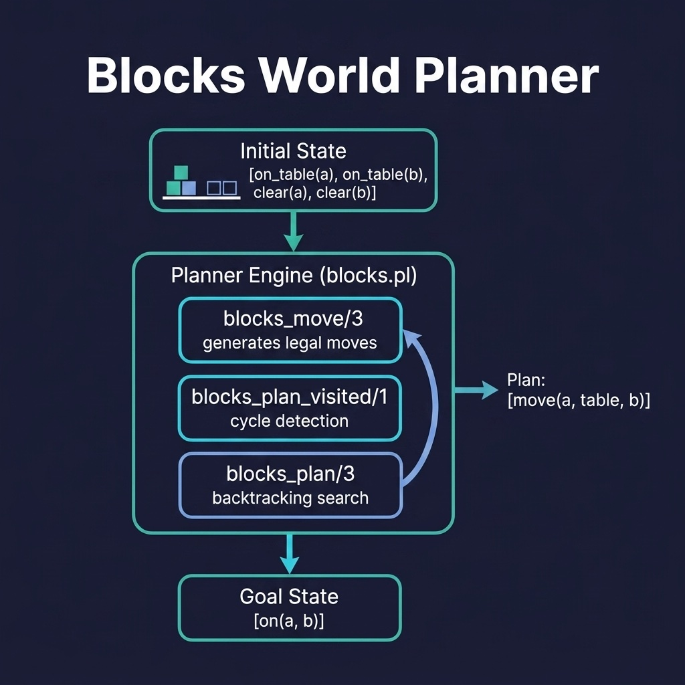

# Blocks World

Classic blocks world planning domain with state tracking. Companion code for the Planning and Scheduling chapter.

## Running Examples

```shell
swipl -s load.pl
```

```prolog
?- blocks_plan([on_table(a), on_table(b)],
               [on(a, b)], Moves).
?- print_state([on(a, b), on_table(b)]).
```

## Running Tests

```shell
swipl -g "['tests/test_blocks.plt'], run_tests, halt" -s load.pl
```


## Architecture



## Description

A dedicated blocks world planner that models moving blocks between stacks and the table. States are lists of `on(X, Y)` and `on_table(X)` atoms. The planner uses `blocks_move/3` to generate legal moves (only a clear block, one with nothing on it, can move). `blocks_plan/3` is breadth-first and returns a shortest plan, for example 3 moves for the Sussman anomaly; `blocks_plan_dfs/3` is depth-first, for comparison. This classic AI domain illustrates how planning problems map naturally to Prolog's search-and-backtrack paradigm.
