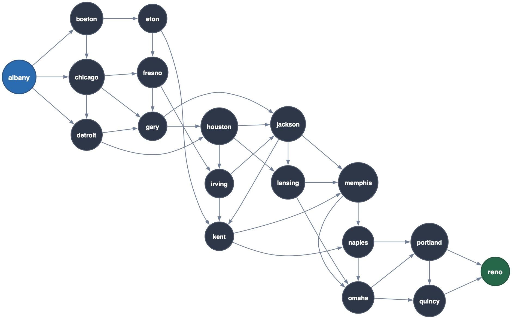
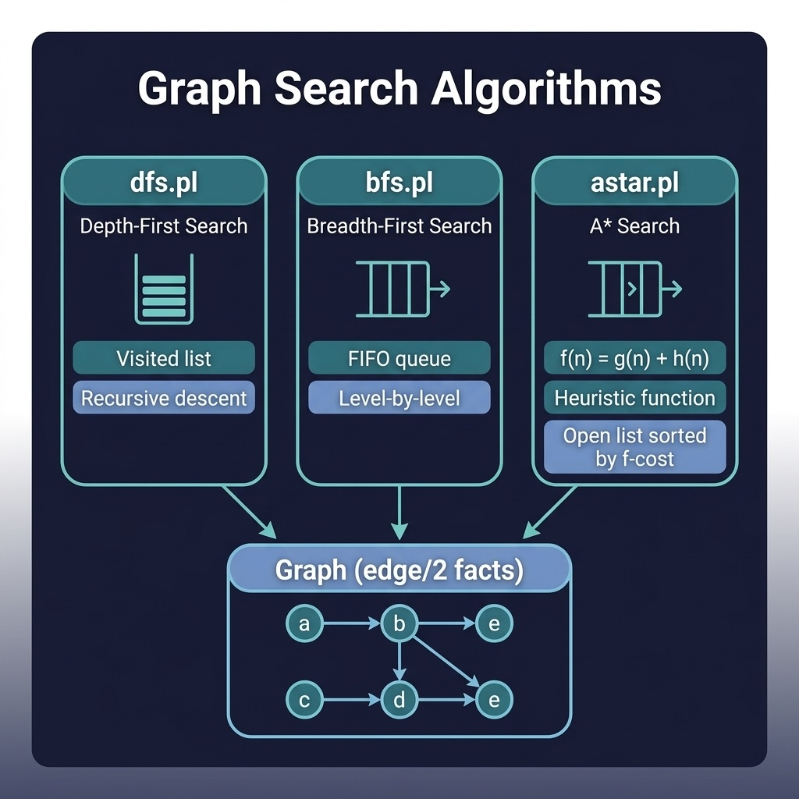

# Graph Search

Depth-first, breadth-first, iterative deepening, and A* search over graphs. Companion code for the Search Algorithms chapter.

## Sample Graph

The search algorithms operate on an 18-node directed graph loaded at runtime from `sample_graph.txt`:



**Start node:** albany (blue) · **Goal node:** reno (green)

## Running Examples

```shell
cd source-code/graph_search
swipl -s load.pl
```

```prolog
?- dfs(albany, reno, Path).
?- bfs(albany, reno, Path).
?- ids(albany, reno, Path).
?- astar(albany, reno, distance_heuristic, Path).
```

## Running Tests

```shell
make test
```


## Architecture



## Description

Implements four classic AI search algorithms over a sample directed graph. The graph is loaded at runtime from `sample_graph.txt` by `read_graph.pl`, which asserts `edge/2` facts dynamically. `dfs.pl` performs depth-first search with cycle detection using a visited list. `bfs.pl` uses an explicit queue to explore nodes level by level. `ids.pl` runs a depth-limited DFS with growing limits, both by hand and with `call_with_depth_limit/3`. `astar.pl` implements A* with a pluggable heuristic predicate, keeping an open list sorted by f-cost and re-opening closed nodes when it finds a cheaper path. A missing heuristic predicate counts as 0. `distance_heuristic/2` is admissible, and a unit test checks this.
