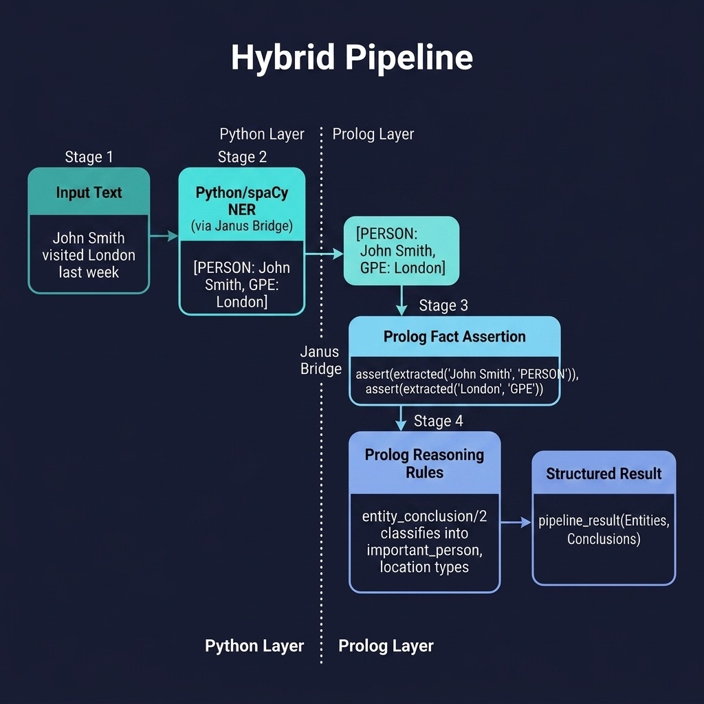

# Hybrid Pipeline

Python NLP preprocessing combined with Prolog reasoning via Janus. Companion code for the Janus Python Bridge chapter.

## Setting Up Janus and Python

Janus embeds the Python that SWI-Prolog was built with, and it uses the packages of the virtual environment named by the `VIRTUAL_ENV` environment variable. So the environment must use that same Python. The Makefile handles this:

```shell
make venv   # uv sync --python /usr/bin/python3
make run
make test
```

For the Homebrew build of SWI-Prolog on macOS, the matching Python is the Command Line Tools Python 3.9 (`/usr/bin/python3`). Its `janus.so` looks for `Python3.framework` only inside `Xcode.app`, so loading Janus can fail with:

```
ERROR: open_shared_object/3: dlopen(.../janus.so, 0x0009): Library not loaded: @rpath/Python3.framework/Versions/3.9/Python3
```

The Makefile works around this by setting `DYLD_FRAMEWORK_PATH=/Library/Developer/CommandLineTools/Library/Frameworks`, which changes nothing on disk. Note that `uv run swipl` does not pass `DYLD_*` variables on, which is why the Makefile calls `swipl` directly with `VIRTUAL_ENV` set. To start an interactive session yourself:

```shell
VIRTUAL_ENV=$PWD/.venv \
DYLD_FRAMEWORK_PATH=/Library/Developer/CommandLineTools/Library/Frameworks \
swipl -s load.pl
```

On Linux, set `PYTHON=python3` (`make venv PYTHON=python3`) and leave out `DYLD_FRAMEWORK_PATH`. The JanusPythonBridge chapter also shows a permanent fix that edits `janus.so` with `install_name_tool`.

`make venv` installs spaCy 3.8.11 and the `en_core_web_sm` model, both pinned in `pyproject.toml`.

## Running Examples

```prolog
?- ner_backend(B).
B = spacy.

?- run_pipeline("John Smith visited London last week", Result).
```

### Fallback behaviour

If spaCy or the `en_core_web_sm` model is not installed, `python/nlp_bridge.py`
falls back to a small rule-based recogniser (`mock_entities/1`) that
knows the names used by the tests (`John`, `Smith`, `London`, `Paris`), so the
pipeline keeps working offline. `ner_backend/1` reports which one is in use.  `extract_entities/1` returns the same shape in
both modes: a list of `{'text': ..., 'label': ...}` dicts that Janus converts
to Prolog dicts in one pass.  Only `PERSON` and `GPE` labels are mapped to
conclusions; other spaCy labels are deliberately dropped.

If SWI-Prolog's Janus extension itself cannot load, the test suite (`tests/test_pipeline.pl`) consults a pure-Prolog mock
(`tests/mock_janus.pl`) instead, so `make test` always exercises the symbolic
layer.

## Running Tests

```shell
make test
```

## Architecture



## Description

A full hybrid AI pipeline: Python/spaCy performs named entity recognition on input text, the extracted entities are asserted as Prolog facts, and Prolog rules classify them (e.g., persons as `important_person`, locations as `location`). This demonstrates the architecture where Python handles statistical NLP and Prolog handles symbolic reasoning, so each language does what it does best.
