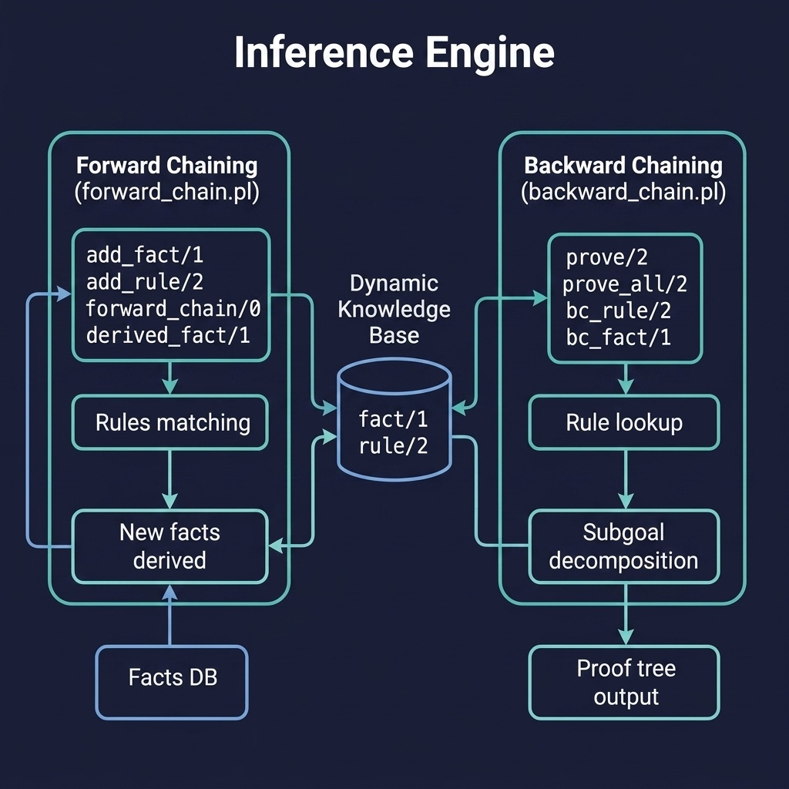

# Inference Engine

Forward and backward chaining inference engines with proof tree generation, plus abduction and default reasoning. Companion code for the Reasoning and Inference chapter.

## Running Examples

```shell
cd source-code/inference_engine
swipl -s load.pl
```

```prolog
?- add_fact(raining), add_rule([raining], wet_ground), forward_chain.
?- derived_fact(wet_ground).
?- abduce(abduction:grass_is_wet, [rained, sprinkler_was_on], E).
?- flies(tweety).
```

## Running Tests

```shell
make test
```


## Architecture



## Description

Implements two fundamental reasoning strategies in two separate modules, each with its own dynamic knowledge base. The `forward_chain.pl` module performs data-driven reasoning over its `fact/1` and `rule/2` predicates. It repeatedly applies rules whose conditions are satisfied by known facts, deriving new facts until no more can be produced (fixpoint); `reset_kb/0` clears its knowledge base. The `backward_chain.pl` module works goal-directed over its own `bc_fact/1` and `bc_rule/2` predicates, starting from a query and recursively trying to prove it via rules and facts, producing a proof tree that explains the reasoning chain; a visited-goal list makes cyclic rule sets fail rather than loop forever, and `reset_bc_kb/0` clears its knowledge base. Both modules use dynamic predicates for facts and rules, making them easy to load with different knowledge bases. The `abduction.pl` module finds sets of assumptions (abducibles) that explain an observation, and `defaults.pl` shows default reasoning with negation as failure (birds fly unless they are penguins or ostriches).
