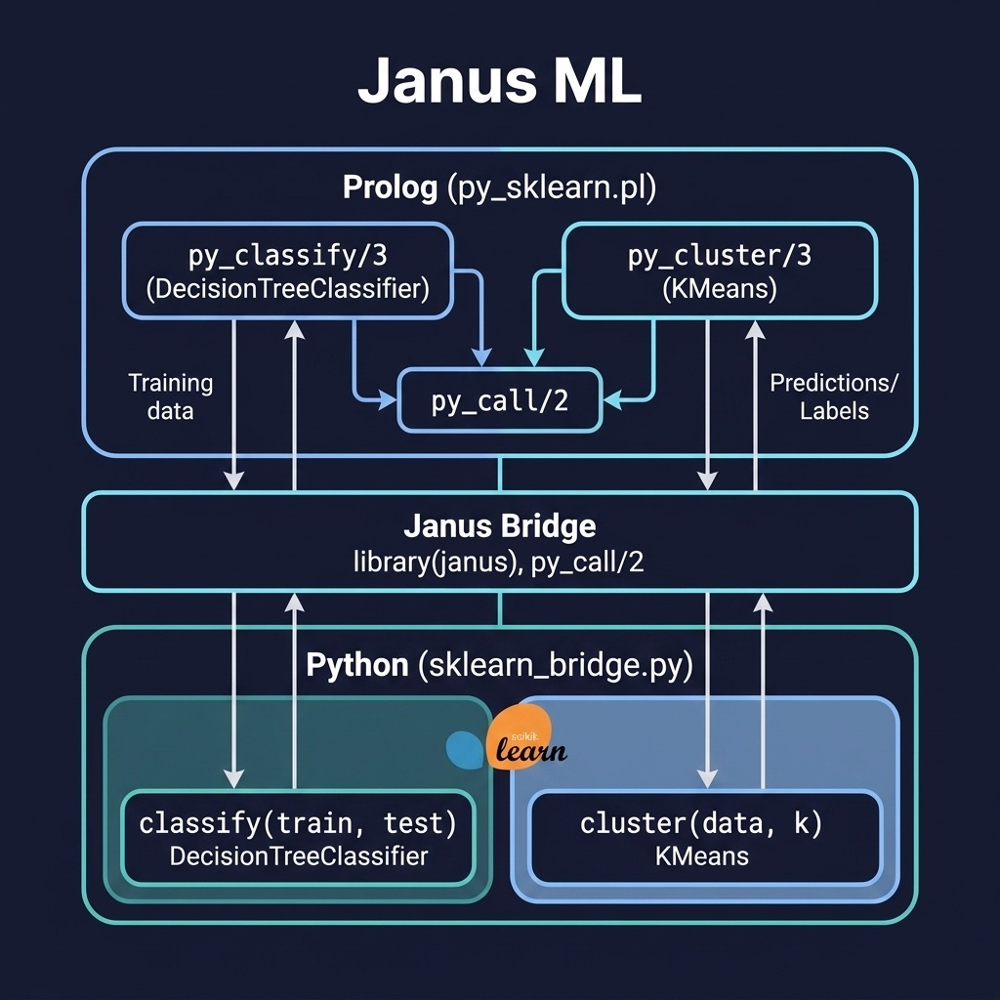

# Janus ML

Call Python's scikit-learn from Prolog via the Janus bridge. Companion code for the Janus Python Bridge chapter.

## Setting Up Janus and Python

Janus embeds the Python that SWI-Prolog was built with, and it uses the packages of the virtual environment named by the `VIRTUAL_ENV` environment variable. So the environment must use that same Python. The Makefile handles this:

```shell
make venv   # uv sync --python /usr/bin/python3
make run
make test
```

For the Homebrew build of SWI-Prolog on macOS, the matching Python is the Command Line Tools Python 3.9 (`/usr/bin/python3`). Its `janus.so` looks for `Python3.framework` only inside `Xcode.app`, so loading Janus can fail with:

```
ERROR: open_shared_object/3: dlopen(.../janus.so, 0x0009): Library not loaded: @rpath/Python3.framework/Versions/3.9/Python3
```

The Makefile works around this by setting `DYLD_FRAMEWORK_PATH=/Library/Developer/CommandLineTools/Library/Frameworks`, which changes nothing on disk. Note that `uv run swipl` does not pass `DYLD_*` variables on, which is why the Makefile calls `swipl` directly with `VIRTUAL_ENV` set. To start an interactive session yourself:

```shell
VIRTUAL_ENV=$PWD/.venv \
DYLD_FRAMEWORK_PATH=/Library/Developer/CommandLineTools/Library/Frameworks \
swipl -s load.pl
```

On Linux, set `PYTHON=python3` (`make venv PYTHON=python3`) and leave out `DYLD_FRAMEWORK_PATH`. The JanusPythonBridge chapter also shows a permanent fix that edits `janus.so` with `install_name_tool`.

## Running Examples

Once the SWI-Prolog interactive shell opens, you can execute:

```prolog
?- py_classify([[1,0,0],[0,1,1],[1,1,0]], [[0,0,1]], Predictions).
Predictions = [1].

?- py_cluster([[1,2],[3,4],[1,3],[5,6]], 2, Labels).
Labels = [0, 1, 0, 1].
```

Requires SWI-Prolog compiled with Janus support and `uv` installed for Python dependency management.

### Data Formats

- **`py_classify(+TrainData, +TestData, -Predictions)`**:
  - `TrainData`: A list of lists where each inner list contains feature values followed by the class label as the last element (e.g., `[[Feature1, Feature2, Label], ...]`).
  - `TestData`: A list of lists of test samples. You may pass **unlabelled feature vectors** (e.g. `[[Feature1, Feature2], ...]`): the Prolog wrapper passes them to Python as they are. Rows with an extra trailing dummy label are also accepted; the wrapper strips the label.
- **`py_cluster(+Data, +NClusters, -Labels)`**:
  - `Data`: A list of lists of data points to cluster (e.g., `[[Feature1, Feature2], ...]`).
  - `NClusters`: The integer number of clusters to form.

## Running Tests

```shell
make test
```

## Architecture



## Description

Demonstrates the Janus Python bridge for calling scikit-learn's DecisionTreeClassifier and KMeans clusterer directly from Prolog. The `py_sklearn.pl` module provides Prolog predicates that delegate to `python/sklearn_bridge.py` via `py_call/2`. This pattern lets you use Python's mature ML ecosystem while keeping Prolog as the orchestration and reasoning layer.
