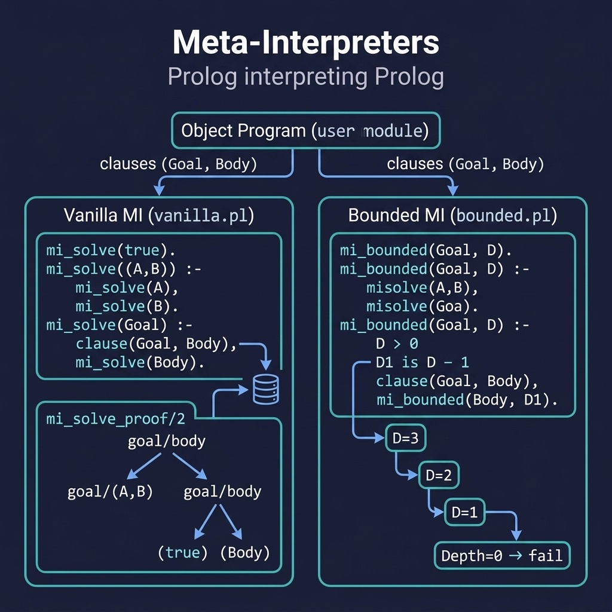

# Meta-Interpreters

Prolog interpreting Prolog: six small meta-interpreters. Companion code for the Meta-Interpreters chapter.

## Running Examples

```shell
make run
```

or in the REPL:

```shell
swipl -s load.pl
```

```prolog
?- mi_solve_proof(sample_kb, grandparent(tom, W), Proof).
?- mi_bounded(sample_kb, grandparent(tom, ann), 2).
?- findall(X, mi_bfs(sample_kb, path(a, X), 1000), Xs).
?- best_cf(sample_kb, see_doctor, CF).
?- mi_trace(sample_kb, older(bob, tom)).
```

## Running Tests

```shell
make test
```

## Architecture



## Description

- `vanilla.pl`: the classic four-clause meta-interpreter (`mi_solve/1,2`) and a variant that builds proof terms (`mi_solve_proof/2,3`).
- `bounded.pl`: a depth limit on rule applications, so every query terminates.
- `bfs.pl`: breadth-first search. Each queue entry keeps its own copy of the goal, so bindings stay correct. It answers left-recursive queries that plain Prolog loops on.
- `certainty.pl`: certainty factors, MYCIN style. Conjunctions take the minimum and rules multiply their certainty in.
- `tracer.pl`: an indented CALL / EXIT / FAIL trace.
- `sample_kb.pl`: a small knowledge base for all of them, including a cyclic graph with a left-recursive `path/2`.
