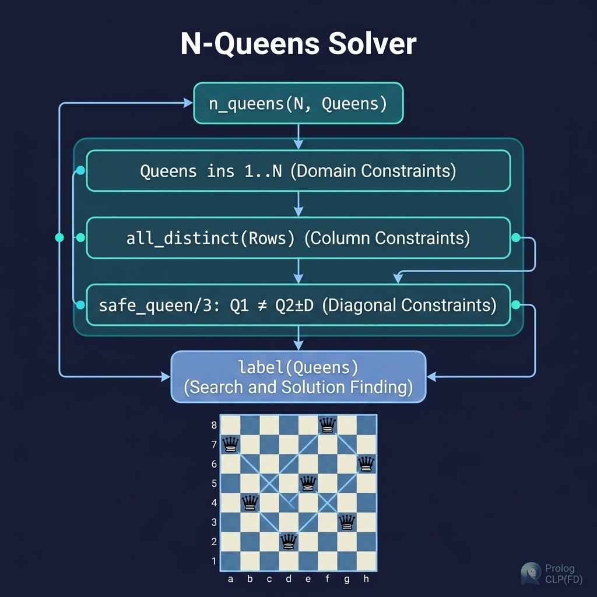

# N-Queens

The N-Queens problem solved with CLP(FD) constraints. Companion code for the Constraint Logic Programming chapter.

## Running Examples

```shell
cd source-code/n_queens
swipl -s load.pl
```

```prolog
?- n_queens(8, Queens).
?- n_queens(4, Queens).
?- n_queens(8, [ff_opt(true)], Queens).  % first-fail labeling
?- aggregate_all(count, n_queens(8, _), Count).
```

`n_queens/3` accepts options; currently `ff_opt(true)` selects
`labeling([ff], Queens)` (first-fail heuristic) instead of the default
`label/1`.

## Running Tests

```shell
swipl -g "['tests/test_queens.pl'], run_tests, halt" -s load.pl
```


## Architecture



## Description

Places N queens on an N×N chessboard so no two queens attack each other. The solution uses CLP(FD) constraints to enforce that no two queens share a row, column, or diagonal. The `safe_queen/3` predicate encodes the diagonal constraints with arithmetic differences. Compare this short declarative solution with an imperative backtracking version: CLP(FD) propagation prunes the search space, so even large N values are practical.
