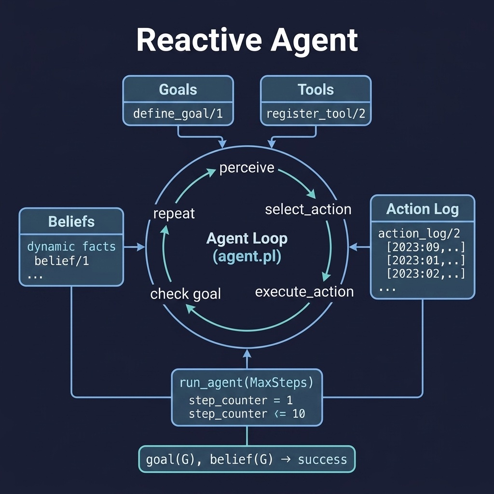

# Reactive Agent

A small agent framework with a perceive, reason, act loop, and a complete example agent: the classic two-room vacuum cleaner world. Companion code for the Building AI Agents chapter.

## Running Examples

```shell
make run
```

or in the REPL:

```shell
swipl -s load.pl
```

```prolog
?- setup_world(a, [a, b]), run_agent(vacuum_world, 10).
Agent: step 1: suck
Agent: step 2: move_right
Agent: step 3: suck
Agent: goals [all_clean] achieved after 3 actions.
```

## Running Tests

```shell
make test
```

## Architecture



## Description

`prolog/agent.pl` holds the framework. An agent has goals (`define_goal/1`), beliefs (`add_belief/1`, `remove_belief/1`), and tools (`register_tool(Name, Goal)`). `run_agent(Agent, MaxSteps)` takes the name of the module that implements the agent, which must define `perceive/0` and `select_action/1`. Each step perceives, stops if every goal is a belief, and otherwise runs the tool for the chosen action and logs it. An action with no registered tool raises an error.

`prolog/vacuum_world.pl` is a complete agent. The robot senses only its own room, remembers which rooms it has seen clean, and chooses actions with three condition-action rules.
