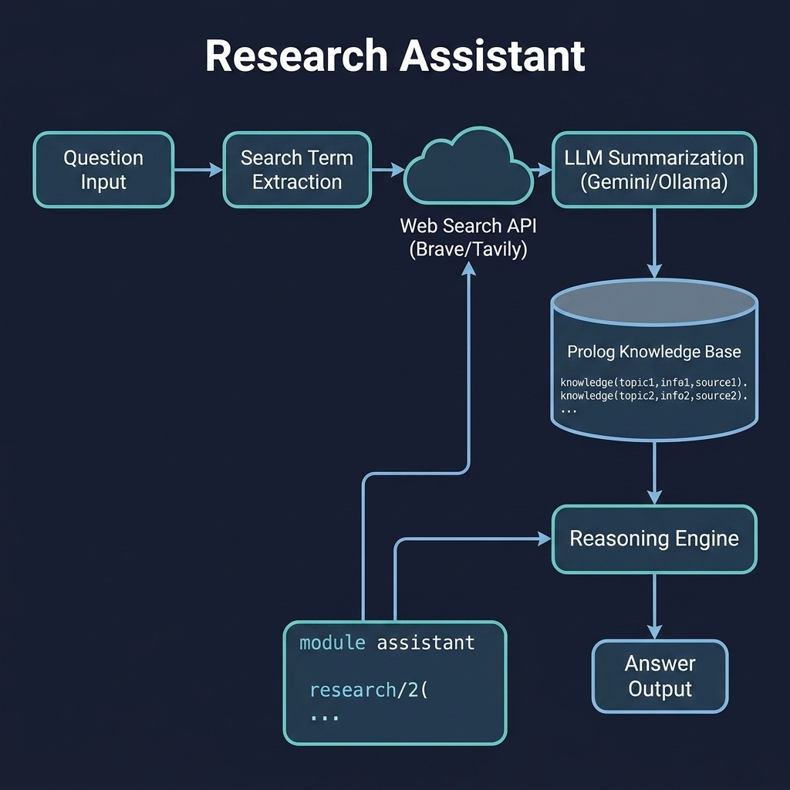

# Research Assistant

An agent that answers research questions by combining web search, a Prolog knowledge base, and an LLM. Companion code for the Building AI Agents chapter.

## How It Works

1. `search_terms/2` drops question words from the question.
2. `wiki_search/3` asks the Wikipedia search API for the top pages (no API key needed).
3. Each page summary is stored as a `knowledge(Title, Summary, URL)` fact. A page already in the knowledge base is not fetched again.
4. Gemini answers from those facts only and cites them as `[1]`, `[2]`, ... The answer ends with the source URLs.

## Running Examples

Needs network access and `GOOGLE_API_KEY`:

```shell
make run
```

```prolog
?- research("Who designed the Warren Abstract Machine and when?", Answer).
?- research("What is unification?", Facts, [llm(false)]).   % no LLM: Title-Summary-URL triples
```

## Running Tests

```shell
make test
```

The tests need no network.

## Architecture



## Description

A practical agent case study that chains together web search (via REST APIs), LLM summarization (Gemini/Ollama), and Prolog knowledge storage and reasoning. The intended workflow: parse the question → search the web → summarize results via LLM → store structured knowledge as Prolog facts → reason over the knowledge base to produce an answer. Currently a skeleton awaiting integration with the `llm_client` and `http_client` projects.
